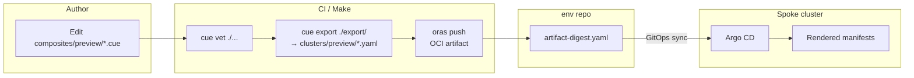
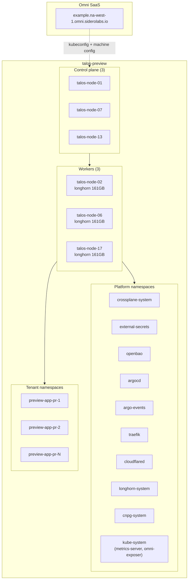
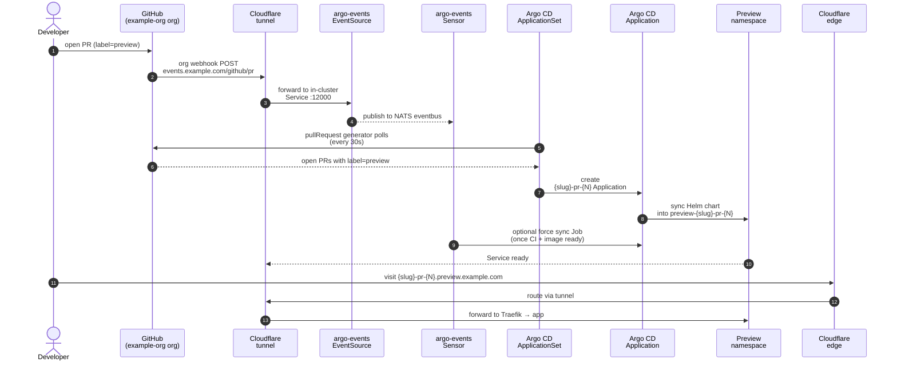
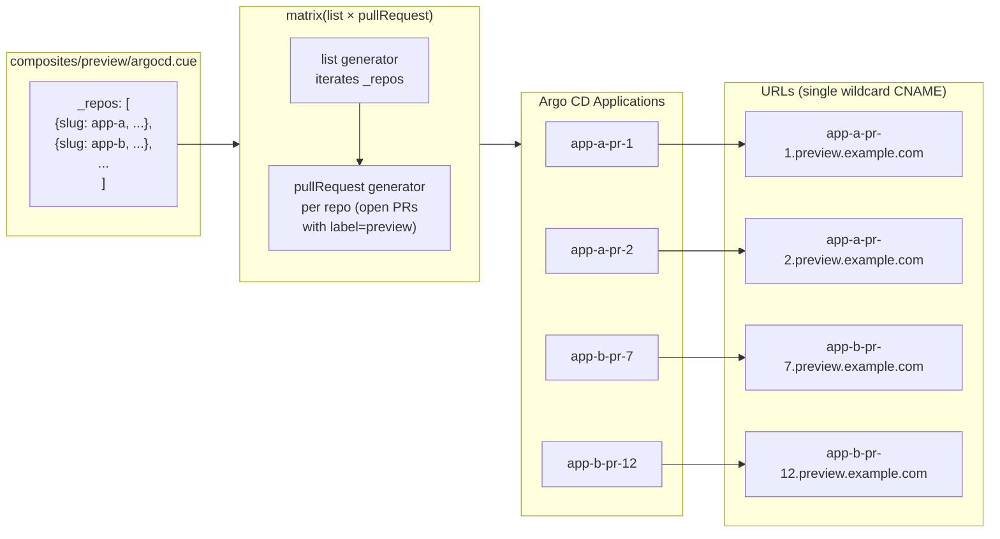
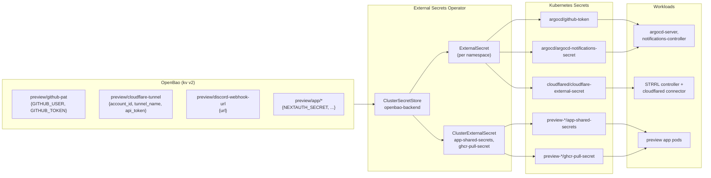
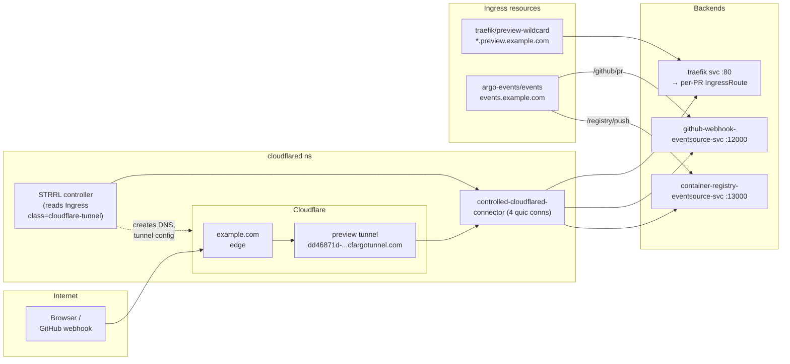
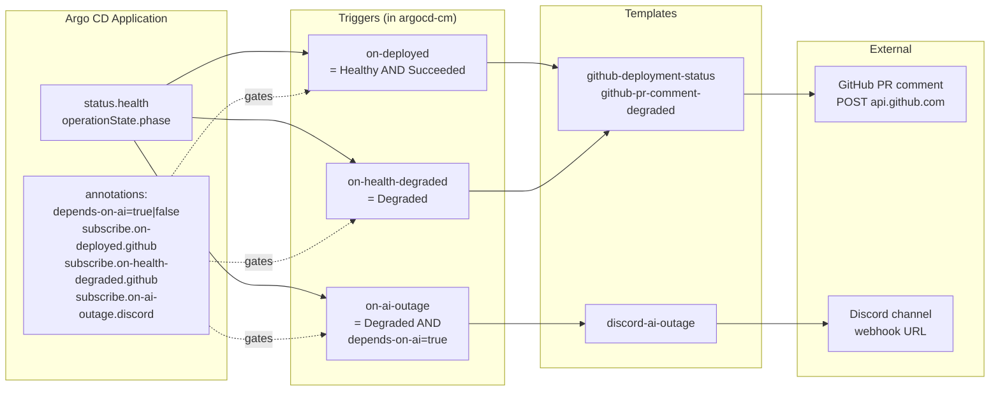
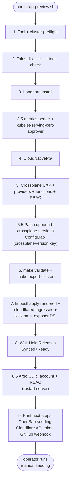

# Architecture Diagrams

Visual companions to [architecture.md](architecture.md) and
[preview-cluster-setup.md](preview-cluster-setup.md). Each diagram
focuses on one flow; together they cover the whole preview platform.

---

## 1. Build + Promotion Pipeline

CUE renders, CI packages as OCI artifact, env repos reference digest,
GitOps applies to spoke clusters.



---

## 2. Cluster Topology (`talos-preview`)

Six Talos nodes managed by Omni SaaS, with the platform namespaces this
repo provisions.



---

## 3. Preview Environment Per-PR Lifecycle

PR opened with `preview` label → Argo CD ApplicationSet creates an
Application → Helm chart deploys into a fresh namespace → Cloudflare
tunnel routes the URL.



---

## 4. Multi-Repo Matrix ApplicationSet

`_repos` list × pullRequest generator → one Application per (repo, PR).



---

## 5. Secret Flow (OpenBao → ESO → Workload)

Single source of truth in OpenBao; ESO syncs into per-namespace Secrets;
workloads consume via env or volume.



---

## 6. Cloudflare Tunnel + Ingress (STRRL)

Edge → tunnel → in-cluster Services. STRRL controller manages tunnel
config, DNS, and the connector Deployment automatically from Ingress
resources.



---

## 7. Argo CD Notification Routing

Application status → triggers → templates → external services. Discord
gets the AI-outage signal only when the Application carries
`preview.example.com/depends-on-ai=true`.



---

## 8. Bootstrap Script Phases

Phases run in order. Idempotent — safe to re-run after partial failure
or chart upgrades.



---

## 9. End-to-End PR Smoke Test

What happens when a developer opens a PR with the `preview` label.

```mermaid
sequenceDiagram
  autonumber
  actor Dev
  participant GH
  participant CF as Cloudflare<br>tunnel
  participant AE as argo-events<br>(EventSource + Sensor)
  participant ACD as Argo CD
  participant App as Helm app<br>(in preview-{slug}-pr-{N})
  participant ESO
  participant OB as OpenBao
  participant Disc as Discord

  Dev->>GH: open PR + label "preview"
  GH->>CF: webhook
  CF->>AE: POST /github/pr
  AE-->>ACD: (sensor is informational; sync<br>still driven by ApplicationSet polling)
  ACD->>GH: list open PRs<br>(uses github-token from ESO)
  GH-->>ACD: PR list
  ACD->>App: create Application + namespace
  ESO->>OB: read secret/preview/app/*
  OB-->>ESO: shared secret values
  ESO->>App: kubernetes Secret<br>app-shared-secrets
  App->>App: pod Ready + IngressRoute live
  ACD-->>GH: post "Preview deployed" comment
  Note over App,Disc: If app is Degraded AND depends-on-ai=true:
  ACD->>Disc: webhook AI outage message
```
